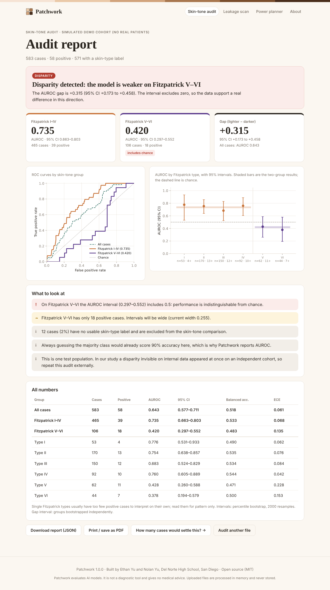
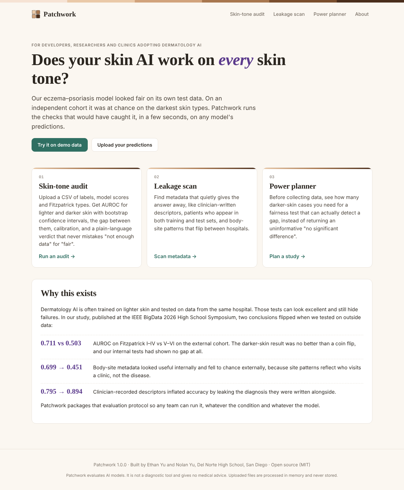
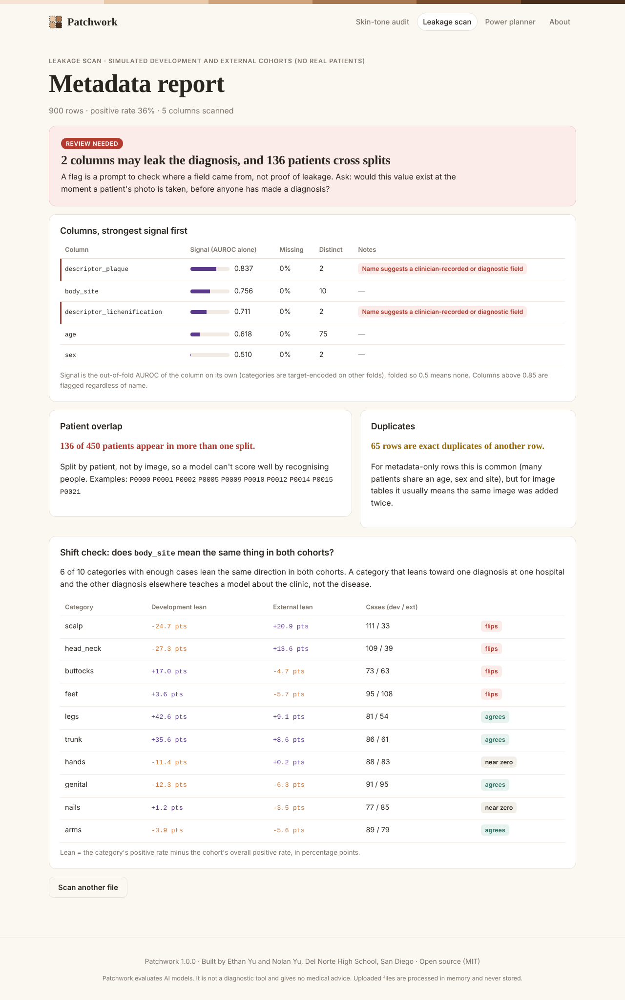
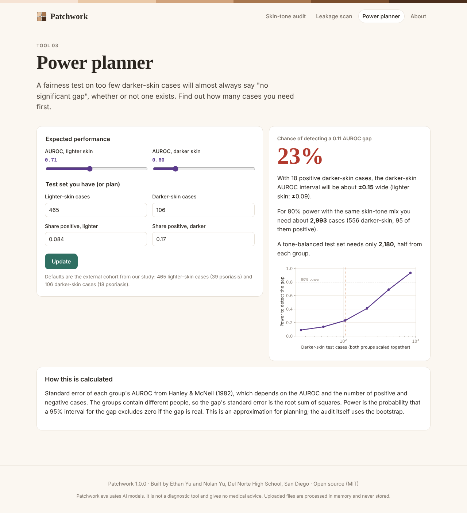

<h1 align="center">Patchwork</h1>

<p align="center">
  <b>Check whether a dermatology AI works on every skin tone, before it reaches patients.</b><br>
  A Python web app for skin-tone-stratified audits, metadata leakage scans and fairness power planning.
</p>

<p align="center">
  
  
  
  <a href="LICENSE"></a>
  
</p>

<p align="center"></p>

---

## The problem

Dermatology AI tools are being built to help doctors, nurses and patients tell skin conditions apart,
especially where there are few dermatologists. Most are trained and tested on data from one source,
and most of that data shows lighter skin. A model can score well on its own test set and still fail
the people with darker skin who were missing from it.

We saw this happen in our own research. Our eczema-vs-psoriasis model showed **no skin-tone gap** on
internal testing, including a test built specifically to probe distribution shift. On an independent
cohort it scored **AUROC 0.711 on Fitzpatrick I–IV but 0.503 on V–VI, which is chance**. Two other
internal findings reversed too: body-site metadata that helped internally fell to chance, and
clinician-written descriptors had inflated accuracy by leaking the diagnosis.

Patchwork turns the checks that caught those problems into a free tool anyone can run in seconds.

## What it does

| Tool | Input | What you get |
|---|---|---|
| **Skin-tone audit** | CSV of true labels, model scores and Fitzpatrick types | AUROC for lighter (I–IV) and darker (V–VI) skin with bootstrap 95% CIs, the gap and its CI, per-type results, calibration, ROC and forest plots, and a plain-language verdict that never treats "not enough data" as "fair". Downloadable JSON and printable report. |
| **Leakage scan** | Metadata CSV (optionally a second cohort) | Each column's signal on its own, flags for fields that leak the diagnosis, patients who appear in both training and test splits, duplicates, and a shift check that shows which categories (like body site) flip meaning between cohorts. |
| **Power planner** | Expected AUROCs and group sizes | The chance a fairness test can detect a real gap, interval widths, and how many darker-skin cases a conclusive test would need. |

Patchwork works on **predictions, not models**, so it is framework-agnostic and works for any binary
skin-condition classifier. It never sees images. Uploaded files are processed in memory and discarded.

## Screenshots

| Home | Leakage scan | Power planner |
|---|---|---|
|  |  |  |

## Run it

Requires Python 3.10 or newer.

```bash
git clone https://github.com/NolanYu1111/patchwork.git
cd patchwork
python -m venv .venv
source .venv/bin/activate        # Windows: .venv\Scripts\activate
pip install -r requirements.txt
python app.py
```

Open <http://127.0.0.1:5000> and click **Try it on demo data**, or upload one of the files in
[`sample_data/`](sample_data/).

### Command line

The same checks run from a terminal or in a CI pipeline:

```bash
python -m patchwork audit sample_data/predictions_demo.csv --fail-on-disparity
python -m patchwork leakage sample_data/metadata_development_demo.csv --patient patient_id --split split
```

`--fail-on-disparity` exits with code 2 when a gap is detected, so a team can block a model release
until it has been checked on every skin tone.

### Tests

```bash
pip install -r requirements-dev.txt
pytest
```

37 tests cover the statistics (AUROC is checked against a brute-force definition), the audit verdicts,
leakage and shift detection, the power calculations and every web route.

## Input format

```csv
case_id,label,score,fitzpatrick
A001,1,0.82,II
A002,0,0.14,V
A003,0,0.37,6
```

- `label`: 1 for the positive class (for example psoriasis), 0 otherwise
- `score`: probability or raw logit for the positive class
- `fitzpatrick`: 1–6, I–VI, or text such as "Fitzpatrick IV"; blanks are reported and excluded

Column names can be anything: the upload form reads your header and lets you pick.

## How it works

```
patchwork/
├── stats.py       AUROC (Mann–Whitney), bootstrap CIs, ECE, balanced accuracy
├── audit.py       skin-tone audit, findings and verdict logic
├── leakage.py     column signal scan, patient overlap, cross-cohort shift check
├── power.py       Hanley–McNeil power and sample-size planning
├── charts.py      Matplotlib charts rendered to inline SVG
├── demo.py        simulated demo cohorts (no real patients)
├── web.py         Flask routes
├── __main__.py    command-line interface
├── templates/     Jinja2 pages
└── static/        CSS and icon
```

Method choices follow the paper:

- **AUROC, not accuracy.** Guessing the majority class already scores 69–90% on these datasets.
- **Intervals, not significance tests.** With ~100 darker-skin cases a test will usually be
  non-significant whether or not a gap exists. Patchwork reports "inconclusive", never "fair".
- **I–IV vs V–VI contrast.** Single Fitzpatrick types rarely have enough positive cases.
- **Out-of-fold leakage scores.** Categories are target-encoded on other folds so a column can't
  score itself.

## Background research

E. Yu, N. Yu and H. Homayouni, "External Validation Reverses Internal Findings in Multimodal
Eczema-Psoriasis Classification Across Skin Tones," *IEEE BigData 2026 High School Symposium*
(Best Paper Finalist). Research code:
[ethany8909/machine-learning-in-eczema-detection-main](https://github.com/ethany8909/machine-learning-in-eczema-detection-main).

## Congressional App Challenge 2026

- **District:** California's 50th (Rep. Scott Peters)
- **Team:** Ethan Yu and Nolan Yu, Del Norte High School, San Diego, CA
- **Platform:** Web · **Language:** Python (with HTML, CSS and a little JavaScript)
- **Demo video:** _link added at submission_

### Use of AI

Anthropic's Claude wrote most of the initial code (statistics, web app, templates, tests, demo data)
and this README, working from our research paper and direction. The research Patchwork is built on,
the methods every check comes from, checking the app's numbers against our real study results,
review and testing, and all final decisions are our own. Patchwork does not call any AI service
while running.

## Limits

Patchwork evaluates AI models. It is **not a diagnostic tool**, does not look at images and gives no
medical advice. A "no gap detected" result covers one test population only: test on an independent
cohort, and on more than one if you can. The power planner uses a normal approximation meant for
planning, not for final claims.

## License

MIT. See [LICENSE](LICENSE).
